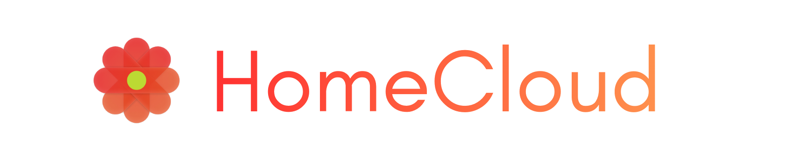
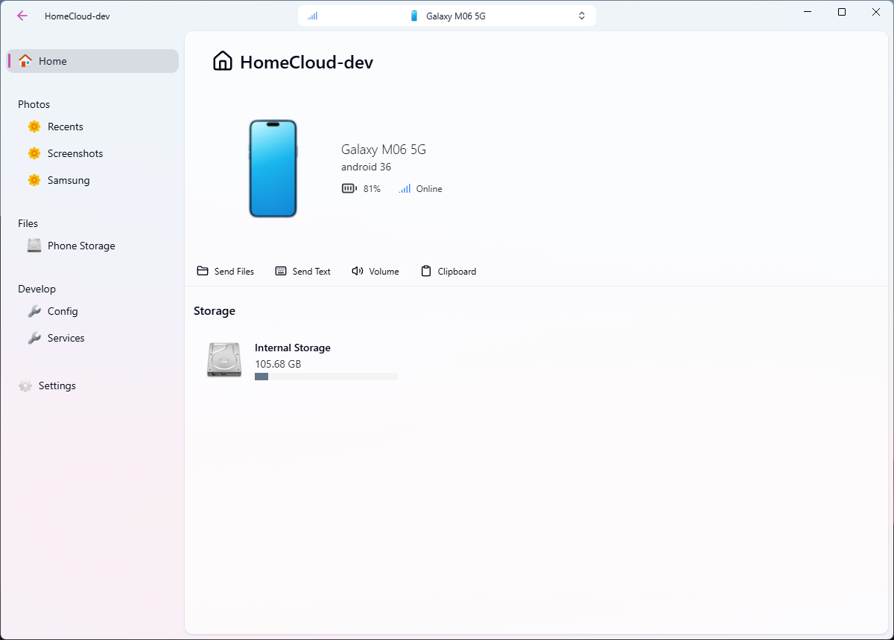
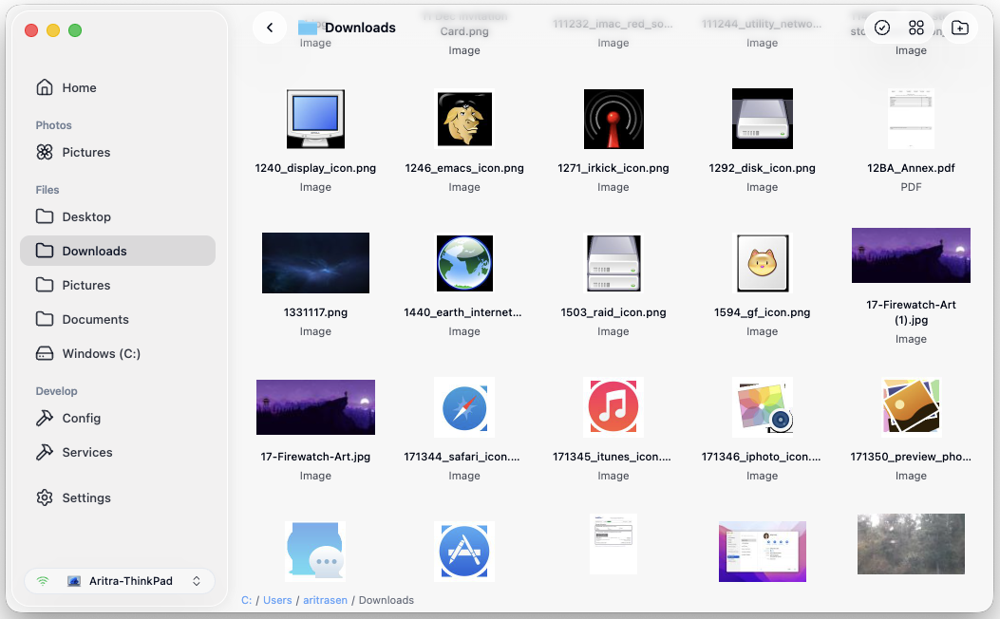
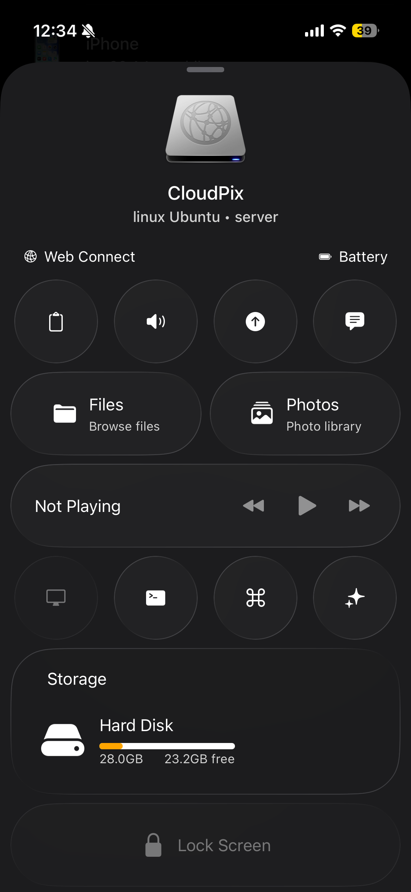
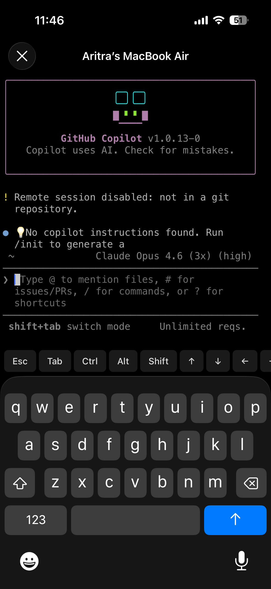
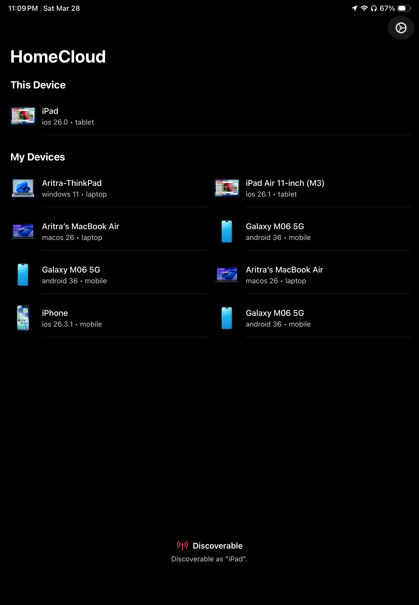

# HomeCloud

    <picture>
        
    </picture>

    <strong>Access your files and devices from anywhere.</strong> 
    Files, photos, clipboard, screen, terminal, automation, over any network.

    <a href="https://asrient.com/homecloud/download">Download</a> · <a href="https://asrient.com/homecloud/docs/help/get-started">Get Started</a> · <a href="https://github.com/asrient/HomeCloud/issues">Report Bug</a>

---

HomeCloud is a free, open-source device hub to access and control your devices across any network. Unlike tools that only work on the same WiFi or requires complex VPN setups, HomeCloud connects your devices seamlessly anywhere you are, while staying fully peer-to-peer.

    
    

    
    
    

## Features

| Feature | Description |
|---------|-------------|
| 📁 **File Access** | Browse, download, open, and edit files on any connected device |
| 📸 **Photo Library** | View and manage phone photos and camera roll from your computer (including HEIC) |
| 📋 **Clipboard Sync** | Copy on one device, paste on another — works across any OS |
| 📤 **Send Anything** | Send files, texts, and links instantly with no size limits |
| 🖥️ **Remote Screen** | View and control your devices remotely |
| 💻 **Terminal** | Open a terminal session to any connected device |
| 🎵 **Media Control** | Control desktop media playback and volume from your phone |
| ⚡ **Automation** | Create and run automated tasks across your devices |

## What makes HomeCloud unique

### Peer-to-peer networking 

All your devices connect to each other directly without routing any personal data to our servers.

### End-to-end encrypted

Devices authenticate using on-device public key cryptography. Your data stays private and fully under your control.

### Easy and quick setup

HomeCloud does not require complex setups for connectivity or pairing. Just login with your same email on every device.

### Connect external tools with MCP

HomeCloud includes a local **MCP (Model Context Protocol)** server. Any MCP-compatible client can use the HomeCloud automation service to access your devices' files, photos, system information, and other exposed services.

## Get started

Download and install HomeCloud on your phones, laptops, and iPads.

- **Desktop**: [Download](https://asrient.com/homecloud/download) for macOS, Windows. Linux coming soon.
- **Mobile**: Currently in early testing - [Download](https://asrient.com/homecloud/download).
- **Server**: Run HomeCloud on your servers - [learn more](https://asrient.com/homecloud/docs/help/server-setup).

See the [Get Started](https://asrient.com/homecloud/docs/help/get-started) for setup instructions.

## HomeCloud vs other device companions

| | HomeCloud | KDE Connect | LocalSend |
|---|---|---|---|
| **Works over internet (P2P)** | ✅ | ❌ Same WiFi only | ❌ Same WiFi only |
| **Truly cross-platform** | macOS, Windows, iOS, Android (Linux soon) | All | All, but file transfer only |
| **File transfer** | ✅ | ✅ | ✅ |
| **Clipboard access** | ✅ | ✅ | ❌ |
| **Remote screen** | ✅ | ❌ | ❌ |
| **Remote terminal** | ✅ | ❌ | ❌ |
| **Phone photos on desktop** | ✅ | ❌ | ❌ |
| **Automation** | ✅ | ❌ | ❌ |
| **No VPN or port forwarding** | ✅ | Needs VPN for remote | Needs VPN for remote |

Most device bridge tool like KDE Connect, LocalSend, Sefirah breaks the moment you leave your home WiFi. People set up entire VPN infrastructure just to get clipboard sync working at the office or a coffee shop.

HomeCloud was built to work on **any network**, local or internet, while staying peer-to-peer. No VPN, no port forwarding, no firewall configs. It just connects.

But connectivity is just the foundation. HomeCloud also gives you things no other device bridge does: browse your phone's photo library from your computer, open remote terminal sessions, run automations, and connect external tools through MCP, all from anywhere, on any OS.

## Contributing

Contributions are welcome! Here's how you can help:

- **Report bugs** or **suggest features** via [GitHub Issues](https://github.com/asrient/HomeCloud/issues)
- **Test the app** on your devices and share your experience
- **Star the repo** if you find it useful ⭐

For development setup and architecture details, see the [Development Guide](docs/Development/Overview.md).

## License

MIT
